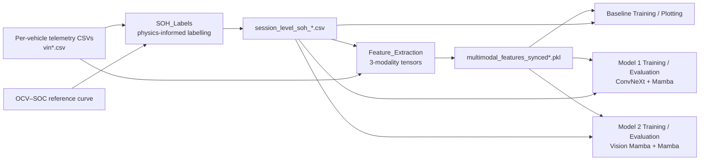

# Battery State-of-Health Estimation from Real-World EV Charging Data using Multimodal State-Space Models

**BEng Dissertation — Mechanical and Electrical Engineering, University of Bath**
**Author:** Francesco Gallo · **Year:** 2026

---

## Overview

This repository contains the code for my dissertation on estimating the **State of Health (SOH)** of electric-vehicle traction batteries from **real-world fleet charging telemetry**, rather than from laboratory cycling data.

The project has two parts:

1. **Physics-informed label generation.** There is no ground-truth capacity measurement in the field data, so session-level SOH labels are estimated from the charging data itself. The method uses Ah-throughput integration (Coulomb counting), an OCV–SOC reference curve with ohmic-drop compensation, and temperature normalisation to 25 °C.
2. **Multimodal deep learning.** Each charging session becomes three input modalities: a 2D cell-voltage map, 1D capacity/temperature sequences, and 15 scalar health indicators. These feed three architectures of increasing complexity:
   - **Baseline:** a multimodal network (`MultiModalSOH`)
   - **Model 1:** a ConvNeXt + Mamba + MLP hybrid (`HeavyMultiModalMambaSOH`)
   - **Model 2:** a fully state-space model with a Vision Mamba cross-scan encoder (`UnifiedMambaSOH`)

Models 1 and 2 are each evaluated over a **5 × 5 matrix**: 5 data-split seeds × 5 weight initialisations, giving 25 models per architecture. This lets the results be reported as means with standard deviations instead of single runs.

The target pack is a **96-series NCM pack with a nominal capacity of 155 Ah**.

---

## Pipeline



---

## Repository Structure

| File | Stage | Description |
|---|---|---|
| `SOH_Labels` | 1 | Session segmentation, Coulomb counting, ohmic-drop-compensated OCV→SOC mapping, thermal normalisation, outlier rejection, and relative SOH with monotonic-degradation enforcement. |
| `Feature_Extraction` | 2 | Parallel (joblib/Loky) extraction of the three input modalities for every labelled charging session. |
| `Baseline_Model_Training` | 3a | Trains the baseline `MultiModalSOH` network with a custom linear-warm-up / exponential-decay LR schedule. |
| `Baseline_Model_Plotting` | 3a | Evaluates the 5 baseline models and produces the residual, parity and seed-stability figure. |
| `Model1_Training` | 3b | Trains 25 `HeavyMultiModalMambaSOH` models (ConvNeXt + Mamba + MLP). |
| `Model1_Evaluation` | 3b | Evaluates all 25 Model 1 runs, builds the results table and produces publication figures. |
| `Model2_Training` | 3c | Trains 25 `UnifiedMambaSOH` models (Vision Mamba cross-scan + Mamba + MLP). |
| `Model2_Evaluation` | 3c | Evaluates all 25 Model 2 runs, builds the results table and produces publication figures. |

> The code was developed as Google Colab notebooks stored in Google Drive and synced to this repository.

---

## Data

The raw dataset is **not included** in this repository. <!-- TODO: add the dataset name, source/citation, and access conditions -->
[DATASET NAME AND SOURCE]

Each vehicle has one CSV file named `vin<ID>.csv`, with the following columns:

| Column | Description |
|---|---|
| `terminaltime` | Timestamp (Unix seconds or datetime string) |
| `chargestatus` | Charging flag (`1` = charging) |
| `soc` | BMS-reported state of charge (%) |
| `totalvoltage` | Pack voltage (V) |
| `totalcurrent` | Pack current (A) |
| `totalodometer` | Odometer reading (km) |
| `maxtemperaturevalue` / `mintemperaturevalue` | Max / min probe temperature (°C) |
| `batteryvoltage` | Serialised string of the 96 individual cell voltages |
| `maxvoltagebattery` | Maximum cell voltage (V) |

You also need an empirical OCV–SOC reference curve (`ocv_reference_curve2.csv`) with the columns `ocv_cell` and `soc`.

---

## Stage 1: Physics-Informed SOH Labels (`SOH_Labels`)

For each vehicle:

1. **Session segmentation.** Charging records are split into sessions wherever there is a gap of more than 30 minutes.
2. **Session filters.** A session is kept only if all of the following hold:
   - average temperature is between 15 and 35 °C;
   - there are at least 100 samples in the 30–90 % SOC window;
   - the SOC window is at least 40 % wide and lasts at least 45 minutes;
   - SOC rises monotonically;
   - mean current is at least 8 A (trickle charging is excluded);
   - no gap in the data exceeds 15 minutes.
3. **Internal resistance.** R_pack is estimated as the median of −ΔV/ΔI over current steps larger than 1 A, constrained to 0.02–0.5 Ω, with a fallback of 0.08 Ω.
4. **Physical start SOC.** The open-circuit voltage is estimated as OCV ≈ V − I·R_pack. It is divided by 96 to get a cell-level value, which is mapped to SOC through the OCV–SOC curve.
5. **Capacity.** Capacity is calculated as C = η_c · ∫|I|dt / ΔSOC, with a Coulombic efficiency η_c = 0.995.
6. **Thermal normalisation.** The capacity is corrected to 25 °C as C₂₅ = C / (1 + α(T − 25)), with α = 0.0025.
7. **Outlier rejection.** Three filters are applied in turn:
   - SOH must lie between 0.65 and 1.10;
   - an IQR filter is applied within each vehicle;
   - sessions that deviate more than 4 % from a rolling-median trend line are removed.
8. **Relative SOH.** Each vehicle's SOH is normalised to an early-life baseline (the 75th percentile of its first 10 sessions). A cumulative minimum is then applied so that capacity cannot regenerate.

**Output:** a session-level CSV containing `vehicle_id`, `session_id`, `start_time`, the estimated capacity, `soh`, `soh_rel_final` and `years_since_start`.

<!-- TODO: if a separate smoothing / vehicle-splitting step produces the
     `soh_final` and `vehicle_id_split` columns used downstream, add that script here. -->

---

## Stage 2: Multimodal Feature Extraction (`Feature_Extraction`)

Each labelled session is matched to its SOH label within a ±30-minute window. Features are then extracted from the 20–85 % SOC region:

| Modality | Shape | Contents | Encoded by |
|---|---|---|---|
| `voltage_map_2d` | 96 × 96 | Each of the 96 cell voltages, interpolated onto a 96-point reference-voltage grid (3.90–4.05 V) | ConvNeXt (Model 1) / Vision Mamba (Model 2) |
| `capacity_seq_1d`, `temperature_seq_1d` | 2 × 151 | Cumulative Ah-throughput (zero-centred) and maximum temperature, interpolated onto a 151-point voltage grid | Mamba + attention pooling |
| `point_features` | 15 | Odometer; mean temperature; mean, median, std and peak-to-peak of the capacity sequence; mean, median, std and peak-to-peak of the cell voltage spread ΔV (mV); max and mean current; max pack voltage; min and mean of the minimum temperature | MLP |

Extraction runs in parallel across all vCPUs. The output is a pickled list of feature dictionaries.

### Pre-processing inside the Dataset class

- **Voltage map:** NaN values are set to 0, then each sample is z-score normalised on its own.
- **Sequences:** values are divided by 100, and NaN values are set to 0.
- **Point features:** z-score normalised using the mean and standard deviation of the **training split only**.
- **Target:** capacity in Ah divided by 155 Ah, which gives normalised SOH.

---

## Stage 3: Models

### Model 1 — `HeavyMultiModalMambaSOH`

- **Image branch:** a ConvNeXt encoder.
  - The stem is a 4×4 convolution with stride 4.
  - There are 3 stages (64 → 128 → 256 channels), each with 3 ConvNeXt blocks (7×7 depthwise convolution, GroupNorm, 4× expansion MLP).
  - Global average pooling is followed by a linear layer to 128 dimensions.
- **Sequence branch:**
  - A temporal position channel is appended to the sequences.
  - The result is projected to 128 dimensions and passed through Mamba (`d_state=32`, `d_conv=4`, `expand=4`).
  - Additive (tanh) attention pooling reduces the sequence to one vector.
- **Static branch:** an MLP 15 → 128 → 64, with LayerNorm, GELU and dropout 0.05.
- **Fusion:**
  - Each branch output is LayerNormed, and the three are concatenated into 320 dimensions.
  - Fusion dropout of 0.03 is applied during training.
  - A regression head 256 → 64 → 1 produces the prediction.

### Model 2 — `UnifiedMambaSOH`

- **Image branch:** a Vision Mamba encoder.
  - A 3-layer stride-2 convolutional stem reduces the 96×96 map to a 12×12 grid of 144 tokens.
  - A learnable positional embedding is added to the tokens.
  - The tokens pass through 3 **cross-scan Mamba blocks**. Each block scans the grid horizontally and vertically, forwards and backwards (4 directional Mamba layers), and fuses the results with a residual connection.
  - Mean pooling gives the branch output.
- **Sequence and static branches:** the same as Model 1, except that the static branch uses dropout 0.06.

### Training configuration

| | Baseline | Model 1 | Model 2 |
|---|---|---|---|
| Optimiser | Adam | AdamW | AdamW |
| Weight decay | 5e-2 | 1e-2 | 1e-3 |
| LR schedule | Linear warm-up (epochs 1–9) to 1e-4, then exponential decay | OneCycleLR, max 1e-3, `pct_start=0.35` | OneCycleLR, max 1e-3, `pct_start=0.35` |
| Loss | MSE on normalised SOH | MSE on normalised SOH | MSE on normalised SOH |
| Epochs / patience | 100 / 100 | 100 / 55 | 100 / 55 |
| Batch size | 128 | 128 | 128 |
| Gradient clipping | 1.0 | 1.0 | 1.0 |
| Sequence noise augmentation | — | σ = 0.01 | σ = 0.001 |
| Checkpoint criterion | Best validation MAPE | Best validation MAPE | Best validation MAPE |

### Experimental protocol

- **Data-split seeds:** `[44, 400, 300, 30, 20]`. Each seed sets an 80/20 random train/test split at session level.
- **Runs per seed:** `a`–`e`, using `run_seed = seed + 1000 × run_index`. This varies the weight initialisation and batch order while the split stays fixed.
- **Metrics:** all are computed in physical units (Ah).
  - **MAPE (%)**
  - **RMSE**, reported as a percentage of the 155 Ah nominal capacity
  - **Maximum absolute percentage error (%)**

---

## Evaluation Outputs

The evaluation scripts rebuild each seed's test split exactly, load the saved weights, and produce the following:

- A per-seed and overall results table (mean ± std over runs).
- Predicted vs. measured SOH and capacity, plotted against the y = x line.
- A histogram of capacity residuals with a KDE.
- Box plots and strip plots of MAPE across seeds, to show model stability.
- Capacity-degradation trajectories over time for the vehicles with the most test sessions.
- Temporal attention weights over the sequence, as an interpretability check.

---

## Running the Code (Google Colab)

1. **Use a GPU runtime.** `mamba-ssm` needs a CUDA GPU; a T4 or better is recommended.
2. **Install the dependencies:**
   ```bash
   pip install mamba-ssm causal-conv1d
   pip install numpy pandas scipy joblib tqdm matplotlib seaborn
   ```
3. **Mount Google Drive:**
   ```python
   from google.colab import drive
   drive.mount('/content/drive')
   ```
4. **Set the paths.** Edit `DRIVE_PREFIX` and `DRIVE_PREFIX2` at the top of each notebook to point to your data folder.
5. **Run the notebooks in order:**
   1. `SOH_Labels`
   2. `Feature_Extraction`
   3. `*_Training`
   4. `*_Evaluation` / `*_Plotting`

### Expected Drive layout

```
MyDrive/
├── ocv_reference_curve2.csv
├── session_level_soh_*.csv            # Stage 1 output
└── Final_Year_Project/
    ├── **/vin*.csv                    # raw telemetry
    ├── multimodal_features_synced*.pkl  # Stage 2 output
    ├── best_soh_model_{1..5}.pth      # baseline weights
    ├── Mamba/
    │   ├── best_MAMBA_{seed}_{a..e}.pth
    │   └── 25_run_ensemble_results.json
    └── Mamba2/
        ├── best_Unified_{seed}_{a..e}.pth
        └── 25_run2_ensemble_results.json
```

---

## Reproducibility Notes

- **Data file versions.** Several versions of the intermediate files were produced during development. The table below lists the version each script reads; update the paths if you regenerate them.

  | Script | Features file | Labels file |
  |---|---|---|
  | `SOH_Labels` (writes) | — | `session_level_soh_physics_final7.csv` |
  | `Feature_Extraction` | writes `multimodal_features_synced6.pkl` | `session_level_soh_natural_final2.csv` |
  | `Baseline_Model_Training` | `multimodal_features_synced4.pkl` | `session_level_soh_natural_final1.csv` |
  | `Baseline_Model_Plotting` | `multimodal_features_synced5.pkl` | `session_level_soh_smoothed_final5.csv` |
  | `Model1_Training` / `Model1_Evaluation` | `multimodal_features_synced2.pkl` | `session_level_soh_smoothed_final2.csv` |
  | `Model2_Training` / `Model2_Evaluation` | `multimodal_features_synced4.pkl` | `session_level_soh_natural_final1.csv` |

- **Determinism.** The training scripts seed Python, NumPy and PyTorch, but they do not enforce full cuDNN determinism, so that GPU kernels stay fast. GPU results may therefore differ slightly between runs. The evaluation scripts do enforce determinism.
- **Splits.** The train/test split is random at **session level**, so one vehicle can have sessions in both train and test. The results therefore measure generalisation to unseen sessions, not to unseen vehicles.
- **Hardware.** [GPU USED, e.g. Colab A100 / T4]

---

## Results

<!-- TODO: fill in from the dissertation -->

| Model | MAPE (%) | RMSE (%) | Max error (%) |
|---|---|---|---|
| Baseline (`MultiModalSOH`) | [ ] ± [ ] | [ ] ± [ ] | [ ] ± [ ] |
| Model 1 (ConvNeXt + Mamba) | [ ] ± [ ] | [ ] ± [ ] | [ ] ± [ ] |
| Model 2 (Vision Mamba + Mamba) | [ ] ± [ ] | [ ] ± [ ] | [ ] ± [ ] |

The values are means ± standard deviations over 25 runs (5 baseline models).

---

## Acknowledgements

Supervisor: [SUPERVISOR NAME], Department of [DEPARTMENT], University of Bath.

This work uses the [`mamba-ssm`](https://github.com/state-spaces/mamba) implementation by Gu & Dao (2023).

## Citation

```bibtex
@thesis{gallo_soh_[YEAR],
  author = {Francesco Gallo},
  title  = {[DISSERTATION TITLE]},
  school = {University of Bath},
  type   = {BEng Dissertation},
  year   = {[YEAR]}
}
```

## License

[LICENSE, e.g. MIT] — see `LICENSE`.
